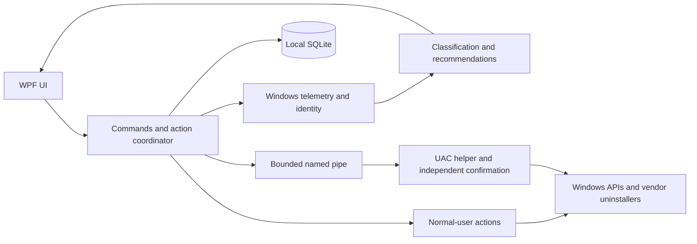
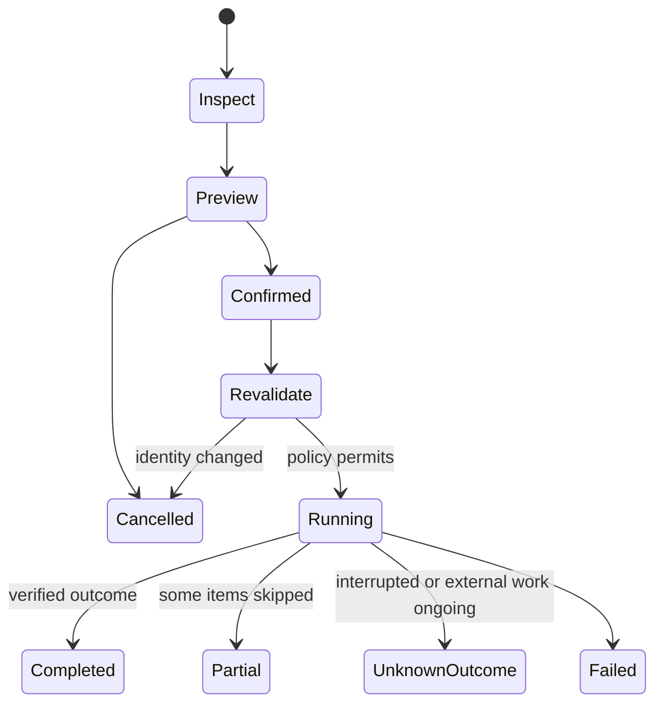

# RamMx architecture

System readings inform the user; they do not authorize stopping a process or deleting files.

## Measurements

GetPerformanceInfo supplies page-count values converted using its page size. Available includes reclaimable standby/free/zero pages; the complement is labelled not-available, not asserted to match Task Manager In use byte-for-byte. [API semantics](https://learn.microsoft.com/en-us/windows/win32/api/psapi/ns-psapi-performance_information).

GetProcessMemoryInfo probes EX2 for private working set and falls back without relabelling shared working set as private memory. CPU is the CPU-time delta divided by elapsed time/logical CPU count. [EX2](https://learn.microsoft.com/en-us/windows/win32/api/psapi/ns-psapi-process_memory_counters_ex2).

Inventory uses registry views/MSIX identities. Shared runtimes remain unresolved workload instances. Signature verification is offline evidence, not a malware verdict. [Process security](https://learn.microsoft.com/en-us/windows/win32/procthread/process-security-and-access-rights), [WinVerifyTrust](https://learn.microsoft.com/en-us/windows/win32/api/wintrust/nf-wintrust-winverifytrust).

## Action lifecycle

Uninstall invokes the original installer/package mechanism and checks inventory. It is not transactional rollback. Leftovers use supported cache recipes with a separate preview/confirmation; no broad registry or folder-name matching. [Uninstall metadata](https://learn.microsoft.com/en-us/windows/win32/msi/uninstall-registry-key), [MSIX removal](https://learn.microsoft.com/en-us/uwp/api/windows.management.deployment.packagemanager.removepackageasync?view=winrt-26100).

## Boundaries

The portable preview is unsigned. Broker mode accepts only two typed operations and cannot run a caller-supplied command. Native uninstall starts in user context; the vendor/Windows installer owns any elevation it requires. Production signing, ACL isolation and VM testing remain necessary before stronger assurances.

See [Context.md](../Context.md) for engineering invariants and [TESTING.md](TESTING.md) for evidence.
