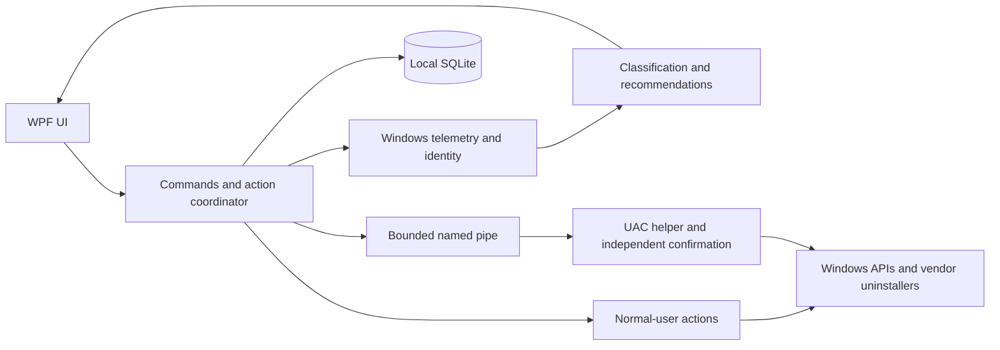
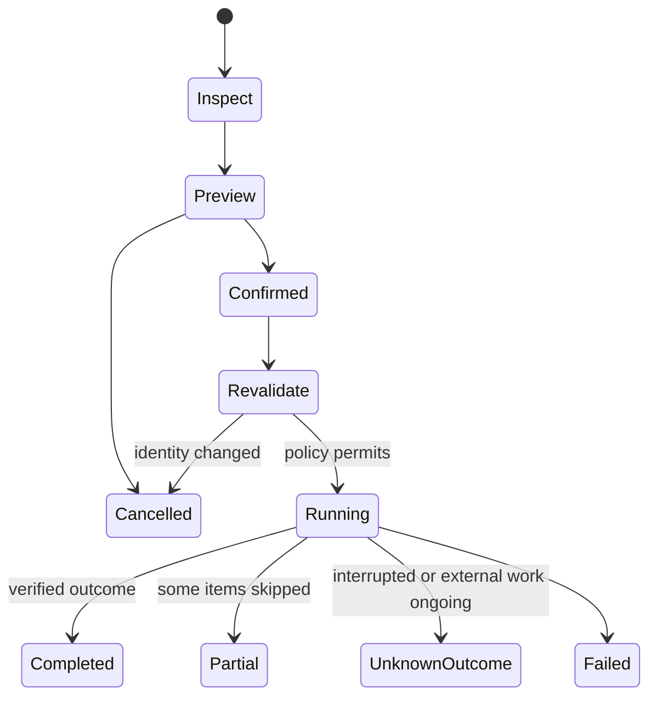
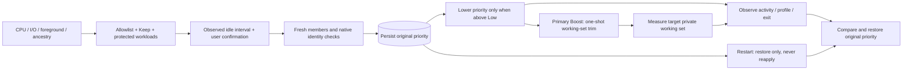

# RamMx architecture

System readings inform the user; they do not authorize stopping a process or deleting files.

## Measurements

GetPerformanceInfo supplies page-count values converted using its page size. Available includes reclaimable standby/free/zero pages; the complement is labelled not-available, not asserted to match Task Manager In use byte-for-byte. [API semantics](https://learn.microsoft.com/en-us/windows/win32/api/psapi/ns-psapi-performance_information).

GetProcessMemoryInfo probes EX2 for private working set and falls back without relabelling shared working set as private memory. CPU is the CPU-time delta divided by elapsed time/logical CPU count. [EX2](https://learn.microsoft.com/en-us/windows/win32/api/psapi/ns-psapi-process_memory_counters_ex2).

Inventory uses registry views/MSIX identities. Shared runtimes remain unresolved workload instances. Signature verification is offline evidence, not a malware verdict. [Process security](https://learn.microsoft.com/en-us/windows/win32/procthread/process-security-and-access-rights), [WinVerifyTrust](https://learn.microsoft.com/en-us/windows/win32/api/wintrust/nf-wintrust-winverifytrust).

## Action lifecycle

Uninstall invokes the original installer/package mechanism and checks inventory. It is not transactional rollback. Leftovers use supported cache recipes with a separate preview/confirmation; no broad registry or folder-name matching. [Uninstall metadata](https://learn.microsoft.com/en-us/windows/win32/msi/uninstall-registry-key), [MSIX removal](https://learn.microsoft.com/en-us/uwp/api/windows.management.deployment.packagemanager.removepackageasync?view=winrt-26100).

## Boost RAM

The primary explicit Boost action trims working sets once for approved apps with continuously observed low activity. It also lowers memory priority to min(original, Low=2). A separate priority-only command gives Windows a reclamation preference without requesting a trim. Neither command increases RAM capacity. See [SetProcessInformation](https://learn.microsoft.com/en-us/windows/win32/api/processthreadsapi/nf-processthreadsapi-setprocessinformation).

The UI defaults to 15 minutes and names the working-set action on the primary button and confirmation. [EmptyWorkingSet](https://learn.microsoft.com/en-us/windows/win32/api/psapi/nf-psapi-emptyworkingset) removes as many resident pages as possible but does not decommit the app's memory; reuse can cause paging and temporary latency. Original priority is recoverable, trimmed residency is not immediately reversible. A persisted entry prevents another trim of the same process during that Boost session, including targets already at priority 1/2. Fresh post-action telemetry compares private working sets only for exact identities actually acted on; missing values stay unavailable and partial coverage is explicit. Machine Available RAM is reported separately and is never presented as reclaimed RAM attributable to Boost.

Codex/Claude/ChatGPT, browsers, development tools and their process relationships are protected. Native browser [Memory Saver](https://support.google.com/chrome/answer/12929150?hl=en) / [Sleeping tabs](https://support.microsoft.com/en-us/edge/learn-about-performance-features-in-microsoft-edge?form=M401RJ) are explained in a help dialog; RamMx does not automate them. Arbitrary suspension is excluded because it can stall locks and background work; [SuspendThread is intended primarily for debuggers](https://learn.microsoft.com/en-us/windows/win32/api/processthreadsapi/nf-processthreadsapi-suspendthread).

## Boundaries

The portable preview is unsigned. Broker mode accepts only two typed operations and cannot run a caller-supplied command. Native uninstall starts in user context; the vendor/Windows installer owns any elevation it requires. Production signing, ACL isolation and VM testing remain necessary before stronger assurances.

See [Context.md](../Context.md) for engineering invariants and [TESTING.md](TESTING.md) for evidence.
